# 候选股票池

> 由 `python candidate_charts.py` 自动生成（2026-10-23 15:54），数据截至 2026-10-23 收盘。改动 `config.toml` 的候选股后，先运行 `fetch_data.py` 更新数据，再运行这个脚本。
> 当前规则：12 只候选股中，每天按满额比例排名，持有前 7 只（已持有的跌出前 10 名才换），每只满额 10%；防守资产 IEF、GLD。规则和原理见 [防守策略研究报告](防守策略研究报告.md)。

## 怎么看这些图

- 每个候选股和防守资产各一张日 K 线图，从 2025-04-01 开始。虚线是 2025-04-02 美国宣布“解放日”关税。
- **K 线**：绿色 = 当天上涨，红色 = 当天下跌（美股习惯，和 A 股的红涨绿跌相反）。价格是复权价（按分红和拆股调整），和行情软件显示的报价会略有差别。
- **蓝色阴影** = 按当前规则持有的日子，颜色越深（越不透明）仓位越大。股票以满额 10% 为最深，防守资产以 37% 为最深。
- **下方小图** = 每天收盘后的持仓占比（占总资产的百分比），虚线是满额。
- 持仓来自回测：用当前规则从 2004 年开始逐日模拟，和模拟盘使用同一套函数。模拟账户 2026-10 才开始运行，所以阴影表示的是“如果一直按当前规则运行，会在什么时候持有、持有多少”。

## 当前状态（2026-10-23 收盘）

| 排名 | 代码 | 名称 | 行业 | 满额比例 | 今天的目标仓位 | 2025-04 以来持有的交易日 | 持有期间平均仓位 | 买入次数 |
|---|---|---|---|---|---|---|---|---|
| 1 **入选** | AAPL | 苹果 | 信息技术 | 100% | 10.0% | 73% | 7.8% | 2 |
| 2  | DIS | 迪士尼 | 通信服务 | 100% | 0.0% | 21% | 8.5% | 1 |
| 3 **入选** | JPM | 摩根大通 | 金融 | 96% | 9.6% | 97% | 9.2% | 2 |
| 4 **入选** | KO | 可口可乐 | 必需消费 | 92% | 9.2% | 93% | 9.8% | 2 |
| 5 **入选** | NVDA | 英伟达 | 信息技术 | 65% | 6.5% | 90% | 5.5% | 1 |
| 6 **入选** | AMZN | 亚马逊 | 可选消费 | 47% | 4.7% | 27% | 6.2% | 3 |
| 7 **入选** | VZ | Verizon | 电信 | 29% | 2.9% | 73% | 8.0% | 4 |
| 8 **入选** | GOOGL | 谷歌（Alphabet A 类股） | 通信服务 | 9% | 0.9% | 64% | 6.8% | 2 |
| 9  | YUMC | 百胜中国 | 餐饮 | 4% | 0.0% | 54% | 6.1% | 2 |
| 10  | NTES | 网易 | 游戏 | 0% | 0.0% | 41% | 6.3% | 2 |
| 11  | PDD | 拼多多 | 电商 | 0% | 0.0% | 12% | 7.4% | 1 |
| 12  | NFLX | 网飞 | 通信服务 | 0% | 0.0% | 29% | 7.4% | 2 |
| — | IEF | 7–10 年期美国国债 ETF | 防守资产 | 趋势向下（持有现金） | 0.0% | 72% | 23.3% | 1 |
| — | GLD | 黄金 ETF | 防守资产 | 趋势向下（持有现金） | 0.0% | 77% | 16.1% | 2 |

“满额比例”= 趋势信号 × min(1, 20% ÷ 最近 20 日波动)；“今天的目标仓位”= 满额 × 满额比例（只有入选的股票才有）。目标和实际持仓相差不到 3 个百分点时不调仓，所以图中的实际仓位和目标会略有差别。

## 候选股（按今天的排名）

### 1. AAPL 苹果（信息技术）

iPhone、Mac 和应用商店、支付等服务

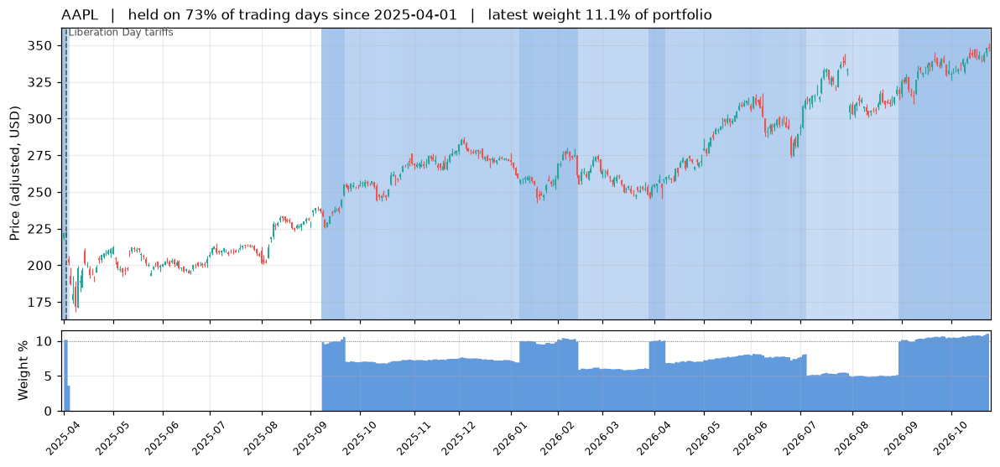

### 2. DIS 迪士尼（通信服务）

电影、主题乐园、Disney+ 流媒体、ESPN

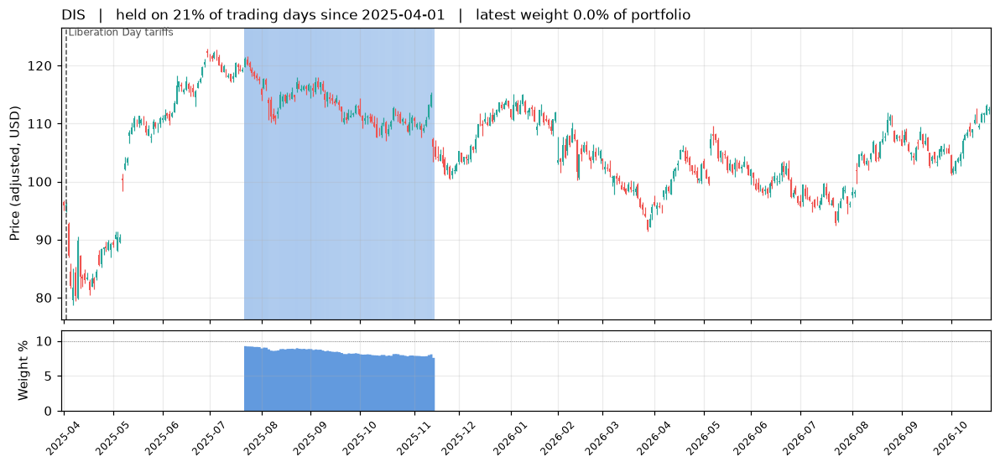

### 3. JPM 摩根大通（金融）

美国最大的银行

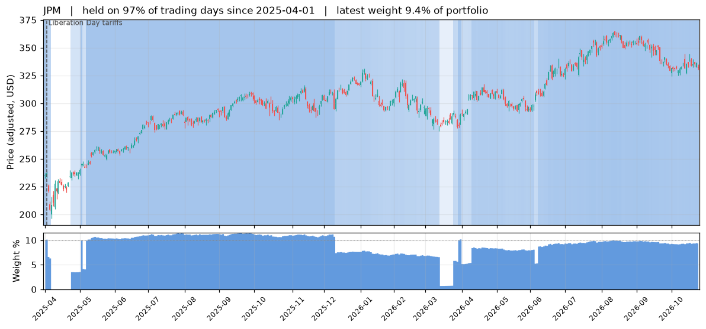

### 4. KO 可口可乐（必需消费）

饮料，经营非常稳定、长期分红

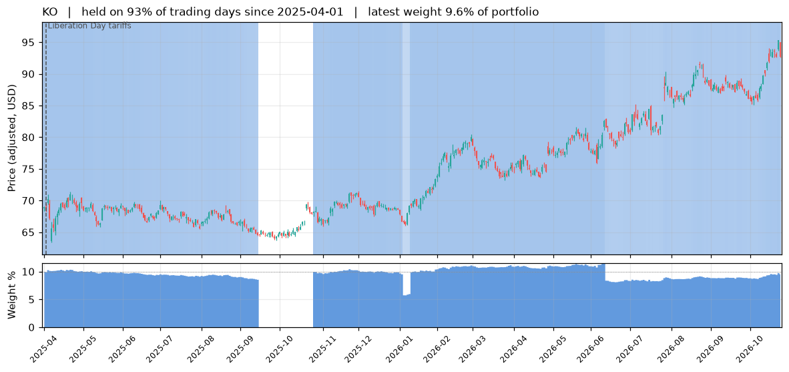

### 5. NVDA 英伟达（信息技术）

GPU 芯片，AI 训练和推理算力的主要供应商

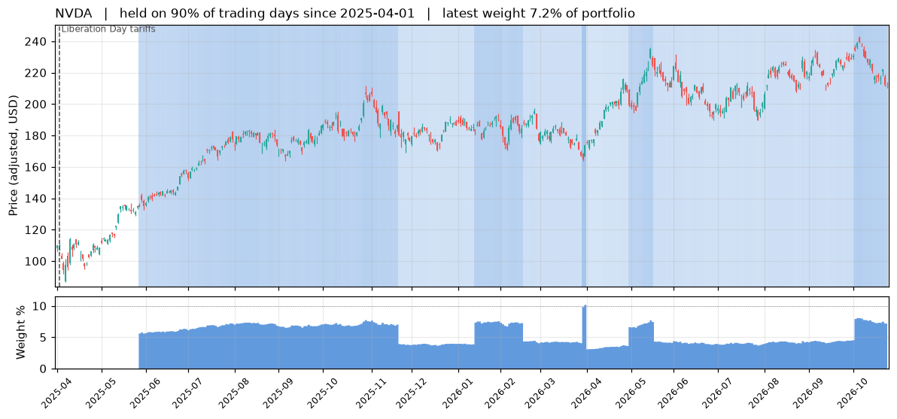

### 6. AMZN 亚马逊（可选消费）

电商和 AWS 云计算（全球最大的云服务商）

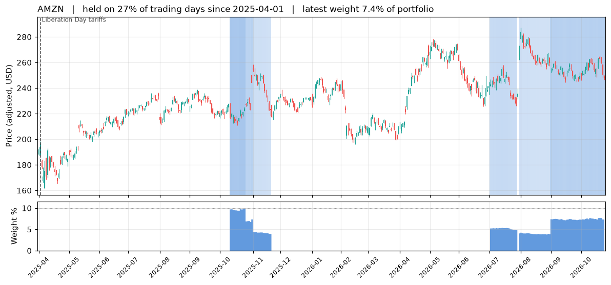

### 7. VZ Verizon（电信）

按营收和用户数是美国最大的电信运营商

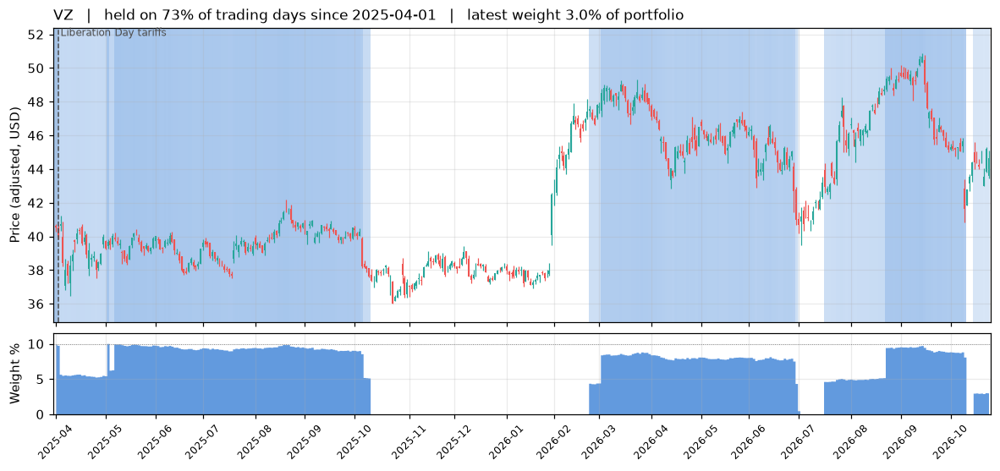

### 8. GOOGL 谷歌（Alphabet A 类股）（通信服务）

搜索广告、YouTube、谷歌云、Waymo 自动驾驶

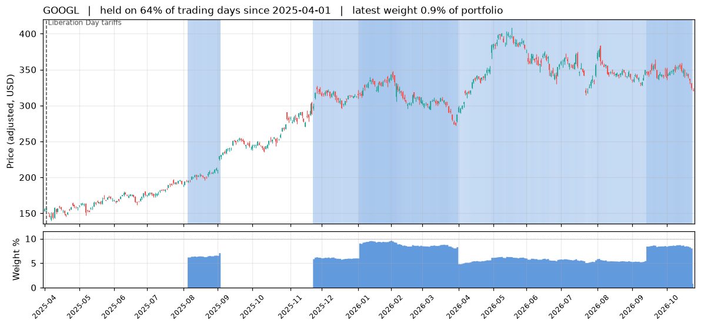

### 9. YUMC 百胜中国（餐饮）

肯德基、必胜客在中国的经营者

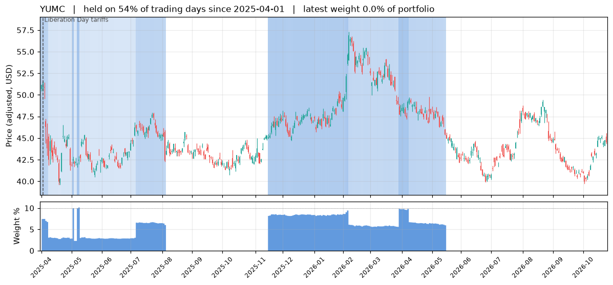

### 10. NTES 网易（游戏）

国内第二大游戏公司，网易云音乐、有道

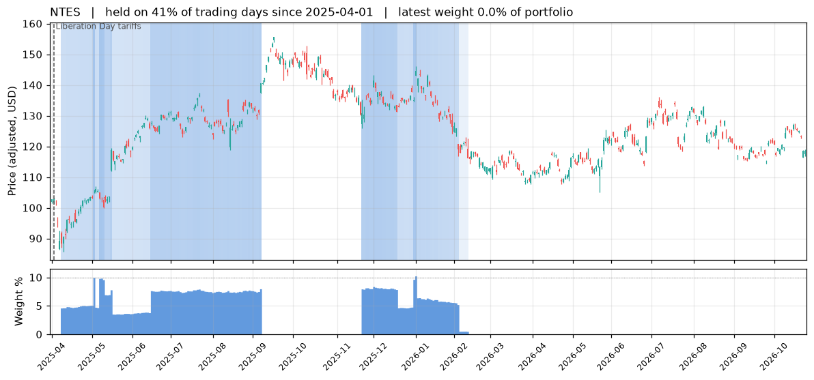

### 11. PDD 拼多多（电商）

拼多多、海外的 Temu

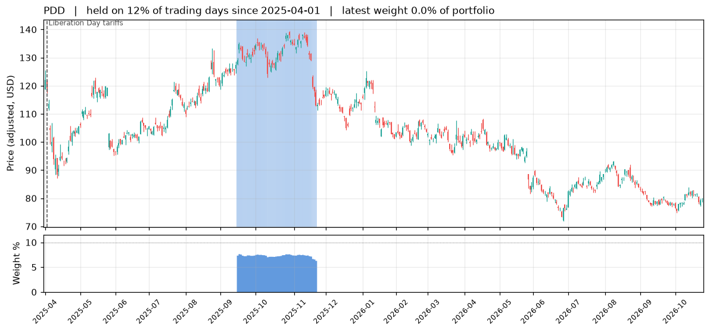

### 12. NFLX 网飞（通信服务）

流媒体视频订阅

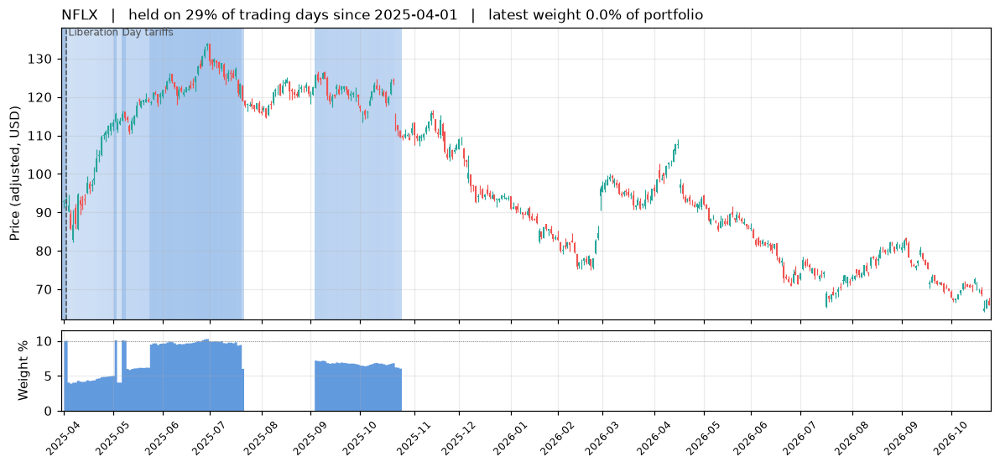

## 防守资产

### IEF 7–10 年期美国国债 ETF

股市下跌时常常上涨；自己低于 200 日均线时那一份改持现金

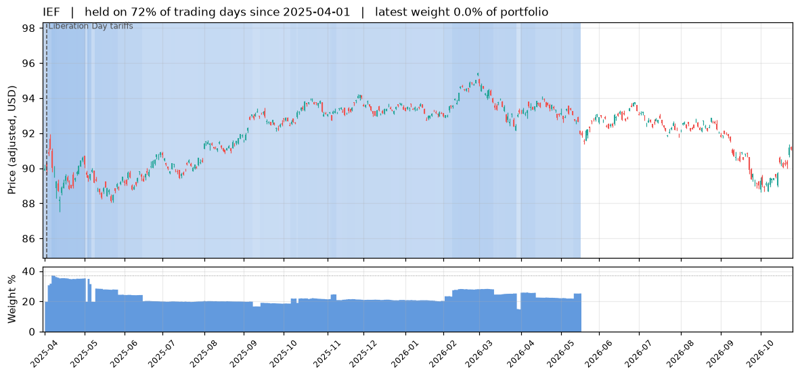

### GLD 黄金 ETF

与股票相关性低的避险资产；自己低于 200 日均线时那一份改持现金

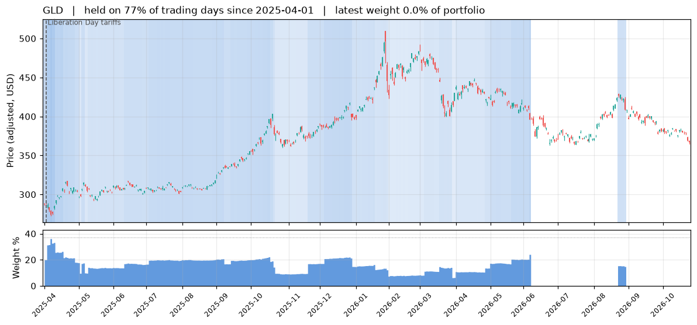

## 本方案与 SPY 比较

同一时间段（2025-04-01 起），起点都是 100：
- **本方案**：按当前规则回测的净值；
- **等额买入持有**：本金 14 等分，在起点买入上面全部候选股和防守资产，之后不再调整；
- **SPY 一直持有**。

上图背景的蓝色阴影是本方案的股票总仓位（越深越高，最深 = 个股份额上限 70%）；下图是本方案每天的资产构成。

| | 区间收益 | 年化 | 最大回撤 |
|---|---|---|---|
| 本方案 | +16.5% | +10.3% | -6.7% |
| 全部 14 个标的等额买入持有 | +26.2% | +16.1% | -11.4% |
| SPY 一直持有 | +38.1% | +23.0% | -12.1% |

期间平均资产构成：股票 51%、IEF 17%、GLD 12%、现金 20%。

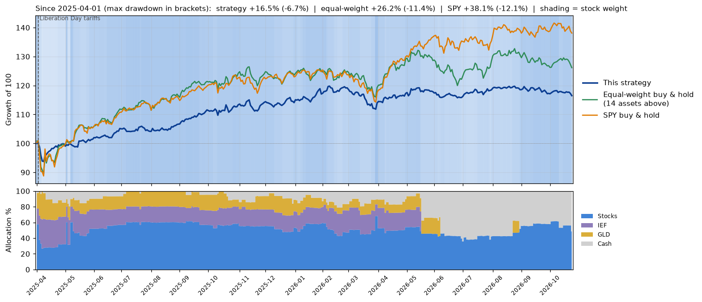

## 长期比较（含 2008、2022 年等熊市）

2006-04-03 起（受黄金 ETF 上市时间和 300 日均线预热限制），起点都是 100。上图是净值（对数刻度：同样的涨跌幅在图上高度相同），粉色区块是历次危机；中图是回撤（离前期最高点跌了多少，虚线是 −20%）；下图是本方案每天的资产构成。

“等分持有”在这里每当偏离超过 5% 就调回等分，已经上市的标的才参与（拼多多 2018 年、百胜中国 2016 年上市）。候选股是现在选定的，长期结果含有后见之明（例如英伟达）。

| | 年化 | 最大回撤 | 夏普 | 2008 | 2011 | 2018 | 2020 | 2022 |
|---|---|---|---|---|---|---|---|---|
| 本方案 | 11.9% | -12.9% | 1.14 | -0.5% | -1.7% | -7.1% | -8.2% | -9.6% |
| 全部 14 个标的等分持有 | 21.4% | -43.3% | 1.06 | -29.2% | -14.0% | -15.0% | -20.1% | -27.7% |
| SPY 一直持有 | 10.9% | -55.4% | 0.55 | -55.4% | -18.7% | -19.4% | -33.7% | -24.5% |

危机列是各次大跌期间（从高点到低点）的累计收益。本方案期间平均资产构成：股票 47%、IEF 17%、GLD 15%、现金 21%。

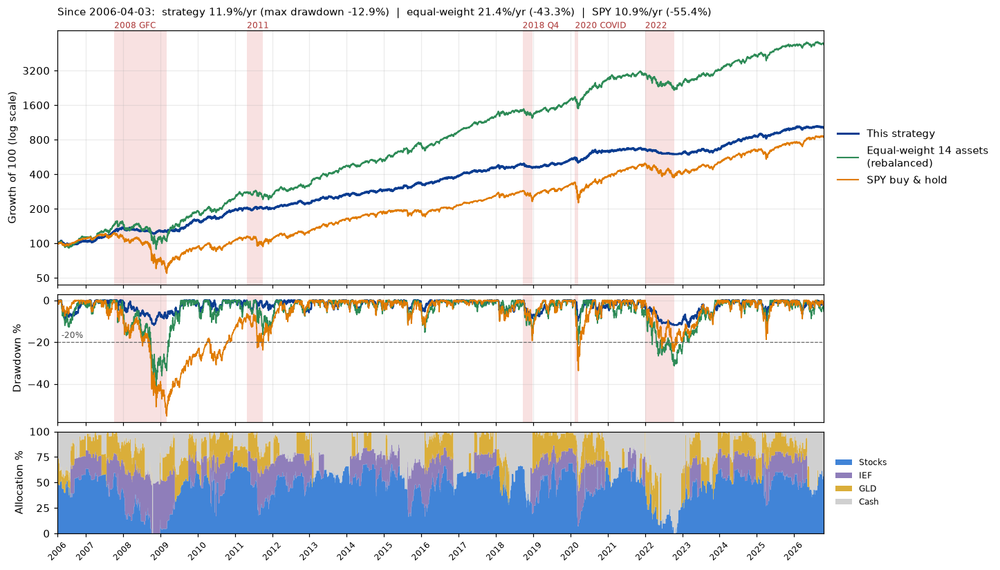
